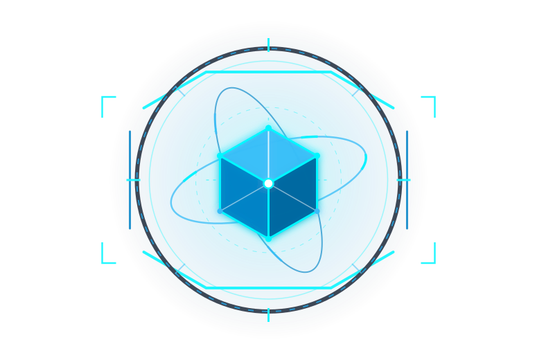

# 🌐 SpatialForge AI — Sovereign Spatial Intelligence

**SpatialForge AI** is a sovereign spatial intelligence, real-time tactical reconnaissance, and bi-temporal geospatial evidence replay platform. It pairs high-fidelity 3D Cesium planetary visualization with deterministic multi-origin sensor adjudication, W3C PROV-O derivation, and SHA-256 evidence bundles.



---

## 🚀 Key Features

* **Photorealistic 3D Globe & Sensor Telemetry:** Real-time satellite tracking, maritime AIS transponders, aircraft ADS-B feeds, seismic events, CCTV streams, and subsea cables.
* **Inception Planetary Motion Splash Screen:** Procedural rotating globe backdrop with SpaceX-class orbital rocket flyoff and particle exhaust effects.
* **Custom Proprietary Vector Logo:** Isometric faceted forge prism with gyroscopic orbital rings and dynamic pointer-gaze tracking physics.
* **8 Unique Tactical Recon Perspectives:** 1-click tactical view switcher with calibrated camera geometry, altitude, heading, and sensor filters:
  1. **Texas Capitol Nadir Recon (Austin, TX):** High-altitude orthogonal satellite surveillance (`30.2747° N, 97.7404° W · 1,180m ALT · -89.5° Pitch · Retro CRT Scanline Filter`).
  2. **Port of Antwerp Approach-A (Belgium):** Maritime bi-temporal adjudication corridor (`51.2750° N, 4.3180° E · 1,650m ALT`).
  3. **SpaceX Pad 39A Launch Complex (Cape Canaveral, FL):** Starship/Falcon launch pad, crawlerway, and orbital flight path (`28.6083° N, 80.6041° W · 1,350m ALT`).
  4. **Strait of Hormuz Chokepoint (Oman / Iran):** Strategic hydrocarbon maritime corridor (`26.5667° N, 56.4500° E · 35,000m ALT · NVG Surveillance Filter`).
  5. **Miraflores Locks (Panama Canal):** Inter-oceanic transit locks with automated transponder gate occupancy validation (`8.9972° N, 79.5931° W · 1,600m ALT`).
  6. **Great Bitter Lake Convoy Grid (Suez Canal, Egypt):** Strategic convoy staging anchorage monitoring subsea telecommunication cable crossings (`30.3333° N, 32.3667° E · 22,000m ALT · FLIR Thermal Filter`).
  7. **Shinjuku Cyber Metropolis (Tokyo, Japan):** Ultra-dense skyscraper canyon with cyber telemetry and commuter transit surveillance (`35.6905° N, 139.6995° E · 950m ALT · Film Noir Filter`).
  8. **Low Earth Orbit Terminator (Global Kinetic Track):** High-altitude satellite reconnaissance track tracing atmospheric limb and day/night boundary (`18.0000° N, 40.0000° E · 4,500km ALT`).
* **Integrated Bi-Temporal Evidence Replay HUD:** Dockable workstation overlay for legal and operational adjudication:
  * Bi-temporal decision replay across `as_of` cutoffs (`14:05:05 UTC` vs `14:05:20 UTC`).
  * 2-Origin Adjudication Rule enforcement (deduplicating single-transponder multi-broker echoes).
  * Canonical SHA-256 evidence bundle generation (`export_bundle`) and delayed stream invariance verification.
  * W3C PROV-O derivation graphs (`wasDerivedFrom`).
* **Autonomous Verification Engine (`engine/`):**
  * 40 unit test suites passing across all pilot gates (D8 False Live, D8 Invariance, D5 Traceability).
  * SOTA Decision Risk validation under Geifman & El-Yaniv (2017) over 300 clustered episodes.
  * Active Sensor Selection under Denzler & Brown (2002) maximizing expected information gain ($\Delta E / \Delta t$).

---

## 🛠️ Quick Start

### 1. Install & Run the 3D Client

```sh
# Install dependencies
npm install

# Start the Vite development server
npm run dev
```

Open **[http://localhost:4173/](http://localhost:4173/)** to launch SpatialForge 3D.

### 2. Run the Verification & Evidence Replay Engine

```sh
cd engine

# Run all 40 unit tests
python3 -m unittest -v

# Run individual gate tests
python3 -m unittest test_port_case.py -v
python3 -m unittest test_false_live.py -v
python3 -m unittest test_traceability.py -v
python3 -m unittest test_antwerp_replay.py -v

# Run Decision Risk benchmark
python3 benchmark_risk_coverage.py
```

---

## 📜 Architecture & Standards

* **Standards:** OGC SensorThings 1.1 · W3C PROV-O · PostGIS Topology
* **Coordinate Basis:** WGS84 Ellipsoid · ECEF Cartesian3
* **Time Synchronization:** UTC (GPS Synchronized)
* **License:** MIT License · SpatialForge Spatial Operations
