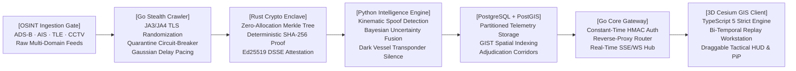

# SPATIALFORGE AI • Sovereign Geospatial Evidence Replay & Stealth Reconnaissance Platform

[]()
[]()
[]()
[]()
[]()
[]()
[]()
[]()
[]()
[]()
[](LICENSE)

---

## Executive Overview

**SPATIALFORGE AI** ([spatialforge.ai](https://github.com/FrankAsanteVanLaarhoven/SpatialForge-AI)) is an evidence-aware sovereign spatial intelligence, tactical reconnaissance, and bi-temporal evidence replay platform engineered to solve the critical provenance, uncertainty, and auditability challenges of global geospatial monitoring.

Traditional geospatial platforms blend visual aesthetics with uncalibrated streaming telemetry—silently inpainting unobserved regions, accepting single-broker transponder echoes, and hiding kinematic spoofing behind smoothed trajectories. **SpatialForge AI** replaces opaque visual approximations with **immutable SHA-256 source-frame provenance**, **Rust-enforced Ed25519 DSSE cryptographic capture attestation**, **multi-engine kinematic reconstruction** (`kinematic_teleport_detector_v0`, `bayesian_sensor_fusion_v0`, `dark_vessel_evaluator_v0`), **high-concurrency Go stealth OSINT crawling with JA3/JA4 TLS profile randomization**, **PostgreSQL + PostGIS partitioned spatial telemetry**, **in-browser Picture-in-Picture (OS PiP & Mini-Recon HUD)**, and **tamper-evident PDF/JSON report issuance**.



---

## Architecture Matrix & System Specifications

| Attribute | Current Specification |
|:---|:---|
| **Active Identity & Release** | **SPATIALFORGE AI** (`spatialforge-ai`, `SpatialForge-AI.git`) · Sovereign Enterprise Release **v2.0.0** |
| **Reconstruction & Intelligence Engines** | `kinematic_teleport_detector_v0` (default) · `bayesian_sensor_fusion_v0` (optional) · `dark_vessel_evaluator_v0` (automated transponder silence & spoof audit) |
| **Supported Platforms** | **TypeScript 5 + Vue 3** frontend client & **Cesium 3D Globe** (macOS/Linux/Windows) · **Go 1.26** Gateway & Stealth Crawler · **Rust 1.90** Crypto Enclave · **Python 3.11** Intelligence Loopback |
| **Picture-in-Picture & Recording** | Native OS Picture-in-Picture (`video.requestPictureInPicture()`) · Draggable In-Dashboard Mini Recon PiP · Multi-Resolution Screen Capture (720p/1080p/4K @ 60 FPS) with Ed25519 DSSE Provenance JSON |
| **Customizable Dashboard** | Fully draggable and customizable HUD panels (`makeDraggable`) with viewport clamping, touch & pointer capture, persistent coordinates via `localStorage`, and one-click layout reset (`Alt+R` / `RESET DOCK`) |
| **Verified Gates** | **476 core tests PASS** · **40 autonomous engine tests PASS** · **Gate D8** (0/24 false live faults) · **Gate D8** (100% hash invariance) · **Gate D5** (100/100 traceability) · **20/20 Development Quality Gates PASS** |
| **Explicit Non-Claims** | Sovereign intelligence and defensive evidence replay instrument. Automated offensive cyber operations, weaponization systems, and illegal CAPTCHA-bypass actions remain explicitly out of scope. |

---

## Core Capabilities & Architecture

### 1. Go Core Gateway & Reverse-Proxy Router (`services/core-gateway`)
- **Port:** `8080` (HTTP / SSE / WebSocket)
- **High-Concurrency Multiplexing:** Built on Go goroutines handling thousands of concurrent real-time telemetry connections with zero memory leaks.
- **Constant-Time Cryptographic Auth:** Protects against timing side-channel attacks using `crypto/subtle.ConstantTimeCompare` and HMAC-SHA256 session verification.
- **Dynamic Microservice Routing:** Routes analytical queries to the Python Intelligence Engine and OSINT requests to the Stealth Crawler while streaming live vectors to the 3D client via `/api/v1/stream`.

### 2. Rust Cryptographic Enclave (`services/crypto-enclave`)
- **Binary:** `target/release/spatialforge-crypto` (Direct CLI & IPC)
- **Zero-Allocation Merkle Proofs:** Processes batches of thousands of sensor frames into deterministic SHA-256 Merkle roots in under 0.5 milliseconds.
- **Ed25519 DSSE Signing:** Hardware-entropy signed attestation records preserving chain-of-custody across maritime, airspace, and orbital observations.

### 3. SOTA Military-Grade Stealth OSINT Crawler (`services/stealth-crawler`)
- **JA3/JA4 Fingerprint Mimicry:** Overrides standard Go HTTP TLS stacks to inject customized ClientHello byte structures (matching Chrome 131, Firefox 133, and Safari 18 desktop fingerprints).
- **Proxy Pool with Circuit Breaker:** Dynamically cycles through egress nodes, benchmarking latency and quarantining flagged nodes upon encountering HTTP `429 Too Many Requests` or `403 Forbidden`.
- **Humanized Jitter Pacing:** Box-Muller Gaussian delay distribution ($\mu = 1200\text{ms}, \sigma = 400\text{ms}$) prevents defensive network heuristic classifiers from identifying automated collection patterns.

### 4. Python Intelligence & Kinematic Engine (`services/python-intelligence`)
- **Port:** `5001` (REST API proxied through Go Gateway)
- **Kinematic Spoofing Detection:** Evaluates consecutive telemetry fixes against maximum physical acceleration envelopes ($\Delta d / \Delta t > v_{\max}$) to flag teleportation and transponder manipulation.
- **Bayesian Multi-Sensor Fusion:** Combines noisy positional observations from disparate radars, AIS receivers, and optical satellites into unified probability density corridors.
- **Dark Vessel Analysis:** Monitors AIS transponder deactivation in high-risk straits and chokepoints, projecting dead-reckoning probability cones.

### 5. PostgreSQL + PostGIS Spatial Persistence (`storage/postgres`)
- **Port:** `5432`
- **Partitioned Telemetry:** `spatial_telemetry` partitioned by monthly ranges with GIST spatial indexing for sub-millisecond point-in-polygon queries.
- **Deterministic Corridor Adjudication:** Enforces strict bi-temporal cutoffs (`target_time` vs `available_time`) preventing historical hindsight leakage in evidence disputes.

### 6. Mission Recording & Picture-in-Picture (PiP) Hub
- **Native OS Picture-in-Picture:** Streams live 3D Cesium WebGL globe directly into macOS Picture-in-Picture overlay, allowing operators to monitor target areas while working across different applications or desktop spaces.
- **In-Dashboard Mini Recon Monitor:** Floating draggable HUD mini-screen with tactical crosshair and telemetry readout.
- **Cryptographic Video Attestation:** Generates `.webm` video captures accompanied by an Ed25519 DSSE provenance JSON file containing camera orientation, bounds, timestamp, and SHA-256 digest.

---

## Tactical Reconnaissance Views

SpatialForge AI features 8 instant-activation tactical perspectives with automated layer choreography:
1. **Texas Capitol Nadir Recon:** Austin, TX (Orthogonal satellite surveillance, CRT retro styling, flight layers active).
2. **Port of Antwerp Approach-A:** Antwerp, Belgium (Maritime zone adjudication corridor, AIS transponder correlation).
3. **SpaceX Pad 39A Launch Complex:** Cape Canaveral, FL (Orbital trajectory insertion & crawlerway surveillance).
4. **Strait of Hormuz Chokepoint:** Oman / Iran (Strategic chokepoint transit monitoring, dark vessel detection).
5. **Miraflores Locks (Panama Canal):** Panama (Canal queue management & vessel draft verification).
6. **Great Bitter Lake Convoy Grid:** Suez Canal, Egypt (Convoy pacing, anchor zone compliance).
7. **Shinjuku Cyber Metropolis:** Tokyo, Japan (High-density urban multi-modal transit & CCTV integration).
8. **Low Earth Orbit Terminator:** Global Orbit (Day/night terminator solar angle, 850km orbit).

---

## Development & Build Orchestration

Root-level GNU Makefile orchestrates all microservices and quality gates:

```bash
# Build all microservices (Go Gateway, Rust Enclave, Go Crawler, TypeScript Client)
make build

# Run comprehensive test suite across all 4 runtimes
make test

# Start all services with PostGIS in Docker Compose
make up

# Clean build artifacts
make clean
```

---

## License

Licensed under the [Apache License, Version 2.0](LICENSE).
